

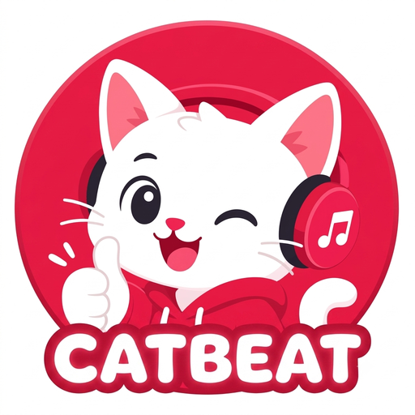

# CatBeat

**Sua música. Seu visual. Seu ritmo.**

Músicas, playlists, letras, personalização e suas estatísticas em um só aplicativo.

**[Site oficial e downloads](https://catbeat-download.vercel.app)**

**[Baixar para Android](https://github.com/GABRIELMSORENSEN/CatBeat-App/releases/download/v1.5.15/CatBeat-1.5.15-Android.apk)** · **[Windows: instalador de testes](https://github.com/GABRIELMSORENSEN/CatBeat-App/releases/download/v1.5.15/CatBeat-1.5.15-Setup-x64.exe)** · **[Windows: portátil de testes](https://github.com/GABRIELMSORENSEN/CatBeat-App/releases/download/v1.5.15/CatBeat-1.5.15-Portable-x64.exe)**

[Conheça as funções](#o-que-você-pode-fazer) · [Veja o aplicativo](#por-dentro-do-catbeat) · [Como instalar](#instalação)

## Por dentro do CatBeat

Capturas reais do aplicativo no Android e no Windows. No celular, veja os visuais usados nos anúncios, gravados em um Galaxy A35 e um Galaxy A17. As telas do Windows usam uma biblioteca demonstrativa.

### No celular: Galaxy A35 e Galaxy A17

O mesmo CatBeat, com duas personalizações diferentes.

| Galaxy A35 | Galaxy A17 |
|:---:|:---:|
| 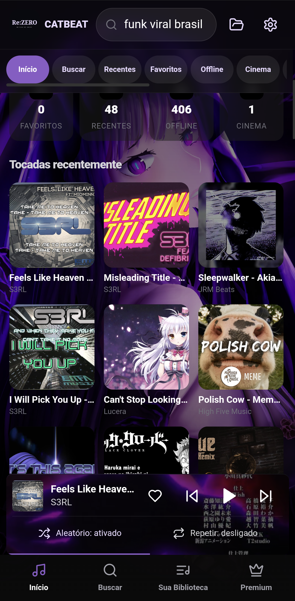 | 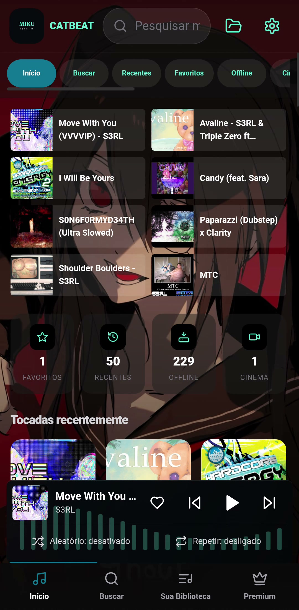 |

### Player e playlists no Android

| Player no Galaxy A35 | Importação de playlists no Galaxy A35 |
|:---:|:---:|
| 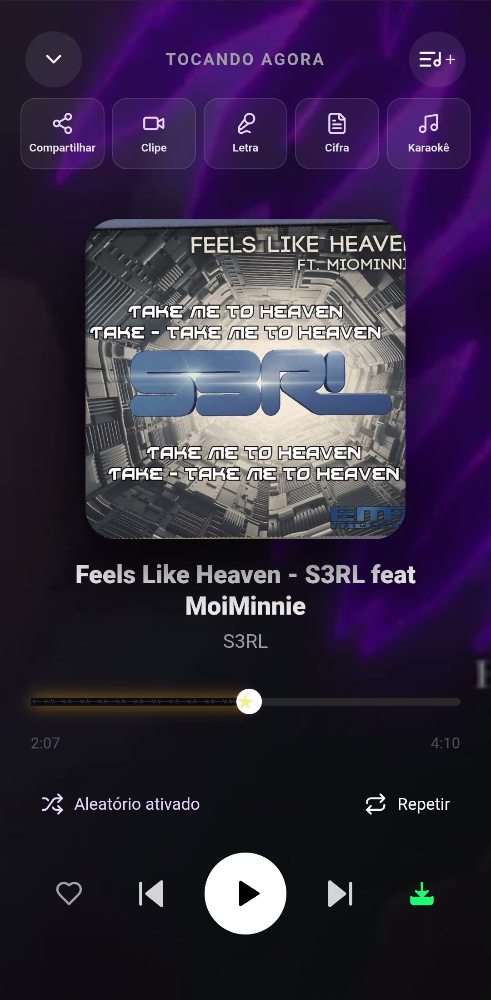 | 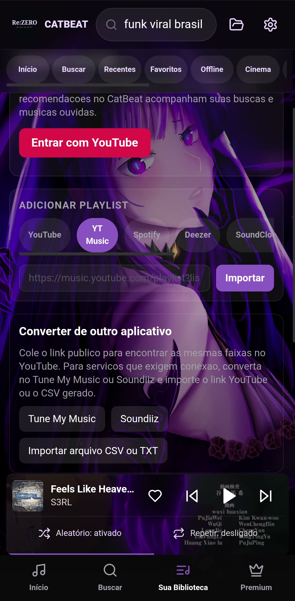 |

<strong>Ver offline, equalizador e wallpapers no Galaxy A17</strong>

| Biblioteca offline | Equalizador e efeitos |
|:---:|:---:|
| 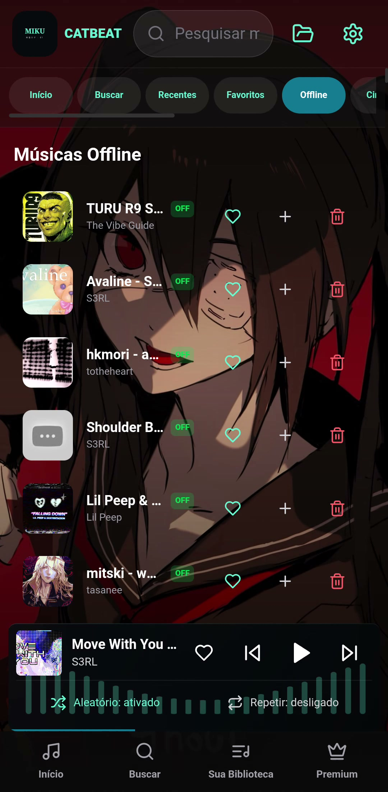 | 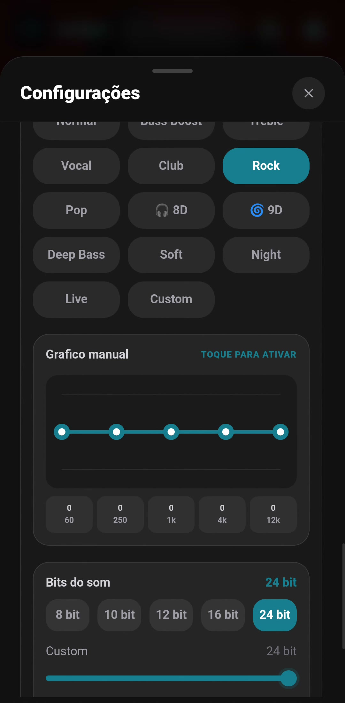 |

#### Wallpapers e personalização

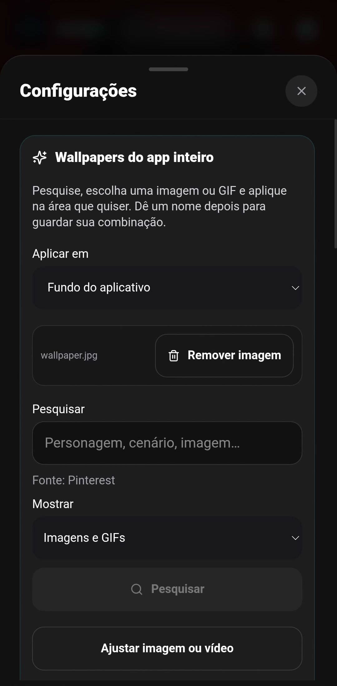

### No computador

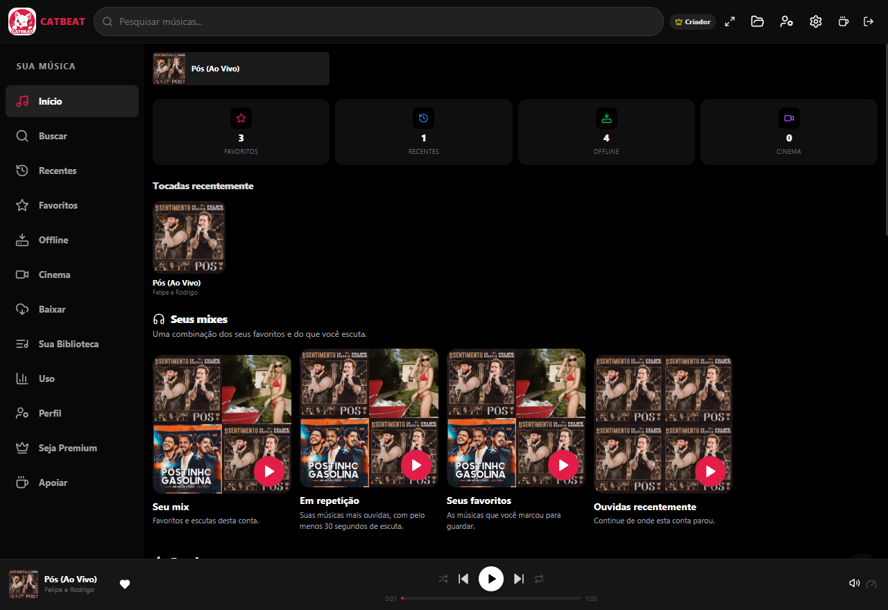

### Layouts compactos no computador

| Interface compacta | Interface alternativa |
|:---:|:---:|
| 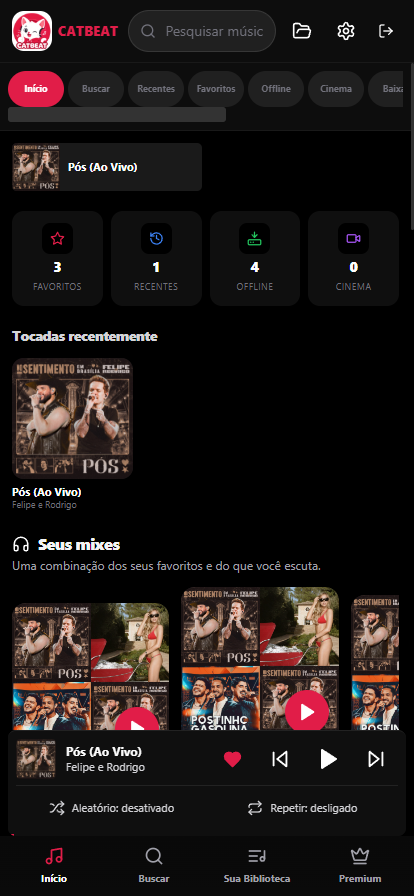 | 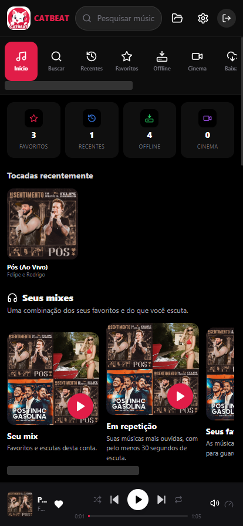 |

### Player, biblioteca e tempo de uso

| Player expandido | Tempo de uso |
|:---:|:---:|
| 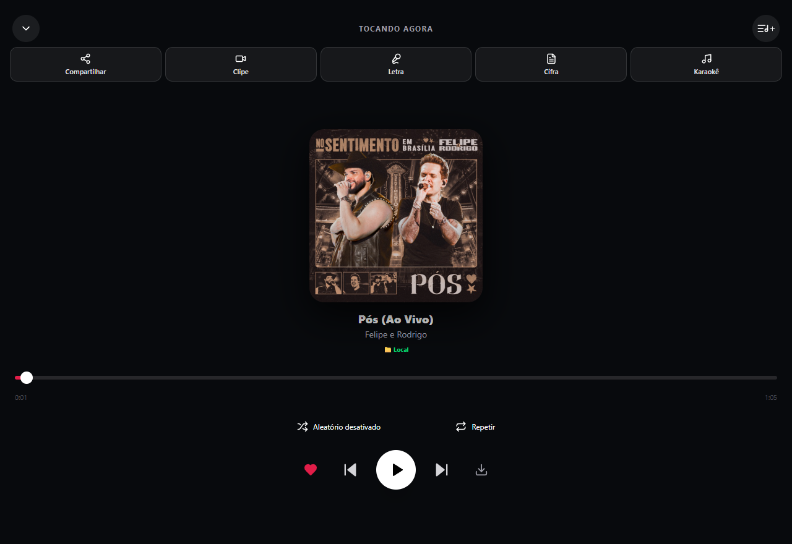 | 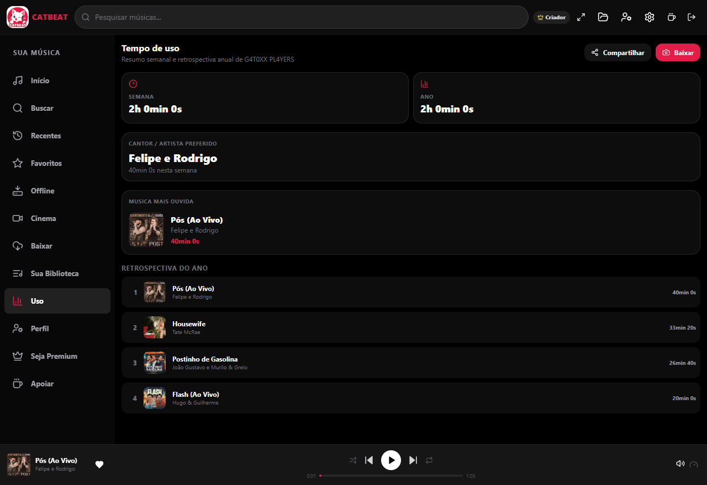 |

<strong>Ver playlists, personalização, equalizador e Discord</strong>

#### Playlists e importação

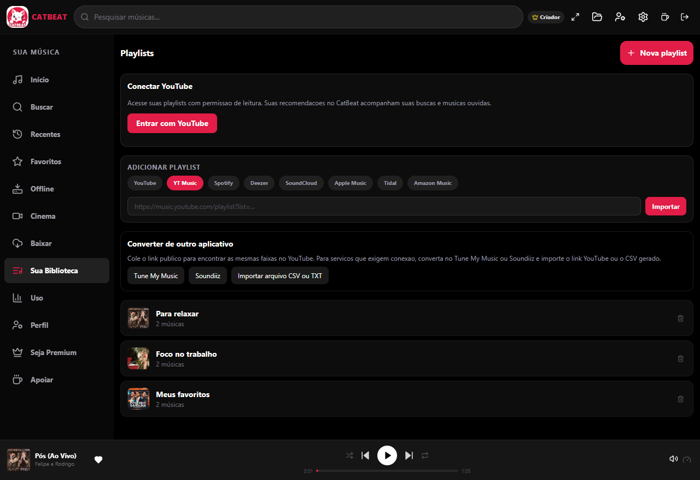

#### Personalização

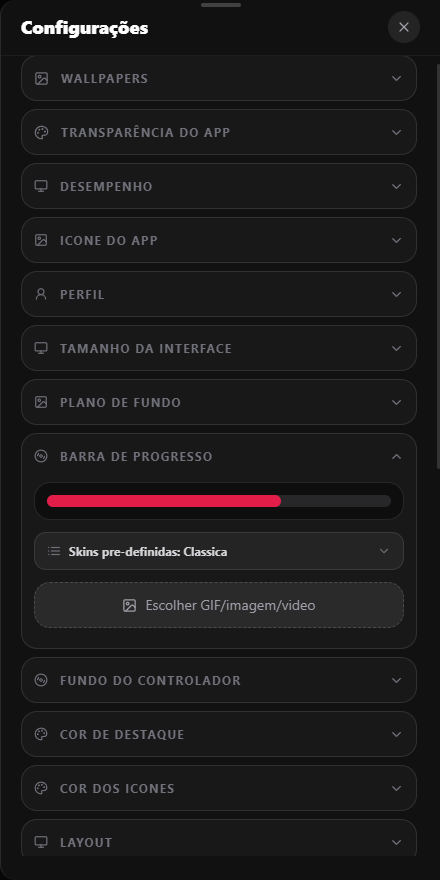

#### Equalizador e efeitos de áudio

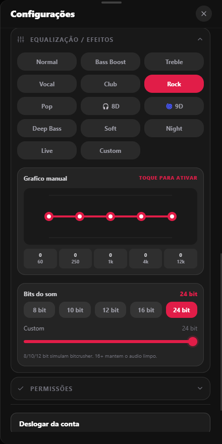

#### Integração com o Discord

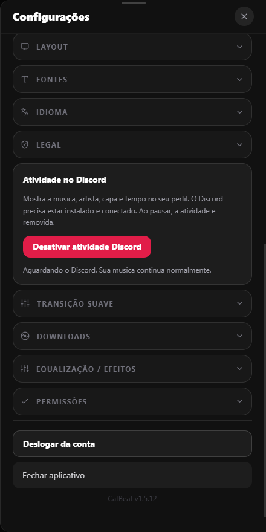

## O que você pode fazer

### Ouvir e descobrir

| Função | No seu dia a dia |
|---|---|
| Busca de músicas | Encontre faixas, artistas, álbuns, playlists e videoclipes, conforme as fontes disponíveis. |
| Mixes pessoais | Ouça seleções baseadas nos seus favoritos e nas suas escutas. |
| Músicas em alta | Descubra o que está tocando no Brasil e explore estilos musicais. |
| Player completo | Controle volume, velocidade, fila, repetição, modo aleatório e favoritos. |
| Reprodução em segundo plano | Continue ouvindo enquanto usa outros aplicativos. No Android, controle a reprodução pela notificação, tela bloqueada e acessórios compatíveis. |
| Cinema e janela flutuante | Assista a videoclipes no modo Cinema e use Picture-in-Picture quando disponível. |
| Sem anúncios no CatBeat | Use o player sem anúncios inseridos pelo aplicativo. |

### Guardar e organizar

| Função | No seu dia a dia |
|---|---|
| Biblioteca local | Toque arquivos que já estão no aparelho, inclusive sem internet e sem login. |
| Favoritos e recentes | Guarde o que gostou e reencontre suas últimas escutas. |
| Playlists próprias | Crie listas, adicione músicas e organize sua seleção. |
| Importação de playlists | Traga listas por links públicos ou arquivos CSV/TXT; o CatBeat procura as faixas correspondentes nas fontes disponíveis. |
| Playlists de outros serviços | Importe listas compatíveis de YouTube, Spotify, Apple Music e Deezer. Isso transfere a seleção de músicas, não assinaturas nem catálogos privados desses serviços. |
| Offline | Salve conteúdo permitido pelas fontes disponíveis e acompanhe fila e progresso dos downloads. Arquivos locais continuam acessíveis sem conexão. |
| Conta e backup | Acesse sua conta e recupere os dados do aplicativo conforme suas configurações. |

### Acompanhar a música

| Função | No seu dia a dia |
|---|---|
| Letras | Acompanhe a letra da faixa, com sincronização quando houver uma versão compatível. |
| Letras offline | Reabra letras que já foram consultadas e estão no cache do aparelho. |
| Cifras | Encontre referências para tocar junto, conforme a disponibilidade da música. |
| Karaokê | Reduza a voz central quando a mixagem permitir; o resultado varia conforme a gravação. |
| Compartilhamento | Compartilhe músicas e sua retrospectiva pelos aplicativos compatíveis. |

### Deixar com a sua cara

| Função | No seu dia a dia |
|---|---|
| Diferentes layouts | Escolha entre interfaces com navegação lateral, superior ou visual familiar. |
| Cores e RGB | Mude destaques, ícones e combinações de cores. |
| Wallpapers | Use imagens, GIFs ou vídeos e ajuste enquadramento, posição, opacidade e desfoque. |
| Player personalizado | Escolha skins, fundos e uma barra de progresso com o seu estilo. |
| Fontes e tamanho | Ajuste a fonte, a escala da interface e a leitura das letras. |
| Perfil | Personalize nome, foto, formato e moldura do perfil. |
| Transparência | Regule a aparência dos elementos sobre o seu fundo. |

### Ajustar o áudio

| Função | No seu dia a dia |
|---|---|
| Equalizador gráfico | Ajuste as frequências manualmente ou escolha um preset. |
| Presets musicais | Experimente Bass Boost, Vocal, Rock, Pop, Club e outros perfis. |
| Efeitos 8D/9D | Explore efeitos espaciais de áudio; o resultado depende do aparelho e da saída de som. |
| Bitcrusher | Experimente uma textura de áudio retrô com os ajustes de bits. |
| Transição suave | Misture o fim de uma faixa com o início da próxima e ajuste a duração. |

### Ver sua atividade

| Função | No seu dia a dia |
|---|---|
| Tempo de uso | Veja quanto tempo passou ouvindo música na semana e no ano. |
| Artistas e faixas favoritas | Descubra quem e o que você mais ouviu. |
| Retrospectiva | Reveja seus destaques e compartilhe sua atividade musical. |
| Discord em tempo real | Mostre música, artista, capa e progresso no seu perfil, com a integração ativada e um cliente Discord instalado, conectado e compatível. |

## Instalação

| Dispositivo | Download | Observação |
|---|---|---|
| Android | [Baixar APK](https://github.com/GABRIELMSORENSEN/CatBeat-App/releases/download/v1.5.15/CatBeat-1.5.15-Android.apk) | Android 7 ou superior. Atualize por cima da versão anterior para preservar os dados. |
| Windows | [Baixar instalador de testes](https://github.com/GABRIELMSORENSEN/CatBeat-App/releases/download/v1.5.15/CatBeat-1.5.15-Setup-x64.exe) | Para instalar no computador Windows de 64 bits. |
| Windows portátil | [Baixar versão de testes sem instalação](https://github.com/GABRIELMSORENSEN/CatBeat-App/releases/download/v1.5.15/CatBeat-1.5.15-Portable-x64.exe) | Abra o aplicativo sem executar um instalador. |

No Android, autorize a instalação pelo aplicativo que você usou para baixar o APK, se o sistema solicitar. Baixe somente pelos canais oficiais.

**Windows em testes:** esta é a versão mais recente disponibilizada para experimentar no PC. Ao relatar um problema, informe a versão do Windows e os passos para reproduzir, sem publicar senhas ou dados pessoais.

## Nesta atualização

- Busque por faixa ou artista dentro da playlist e da biblioteca offline.
- Ajuste a velocidade na Home e abra o equalizador direto do player expandido.
- Sua foto fica ao lado de Premium na barra inferior e abre o perfil com um toque. Foto e banner aceitam GIFs animados.
- Na aba Uso, compartilhe a retrospectiva ou escolha onde salvar o PNG.
- Atualizações futuras aparecem no aplicativo, com opção de lembrar mais tarde.
- Seu mix combina músicas conhecidas com novas recomendações baseadas no seu gosto.
- Modo local sem login dedicado aos seus próprios arquivos. Downloads da conta não são transferidos para outra conta nem para esse modo.
- Permissões e bateria e atividade no Discord abrem e fecham como as outras opções. A integração Discord começa habilitada quando não há uma preferência salva; sua escolha anterior é respeitada.
- Novo site oficial com telas reais no celular e no PC, downloads, termos e privacidade.

**iOS:** em preparação, ainda sem aplicativo disponível para instalar. O CatBeat ainda não foi publicado na Play Store ou na App Store.

## Antes de usar

A disponibilidade dos recursos varia conforme a plataforma, o plano da conta, o aparelho e a fonte do conteúdo. Consulte as condições dentro do aplicativo.

**YouTube:** a conexão com playlists privadas ainda depende da liberação do Google. A biblioteca local e as formas compatíveis de importação por links públicos ou arquivos não exigem essa conexão.

CatBeat é um aplicativo independente, sem afiliação com os serviços de música e comunicação mencionados. Use apenas conteúdo ao qual você tem direito de acesso.

---

© 2026 CatBeat. Todos os direitos reservados.
